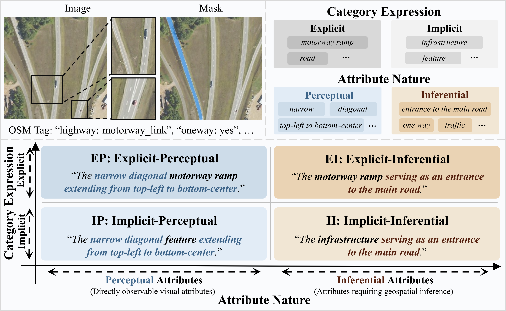
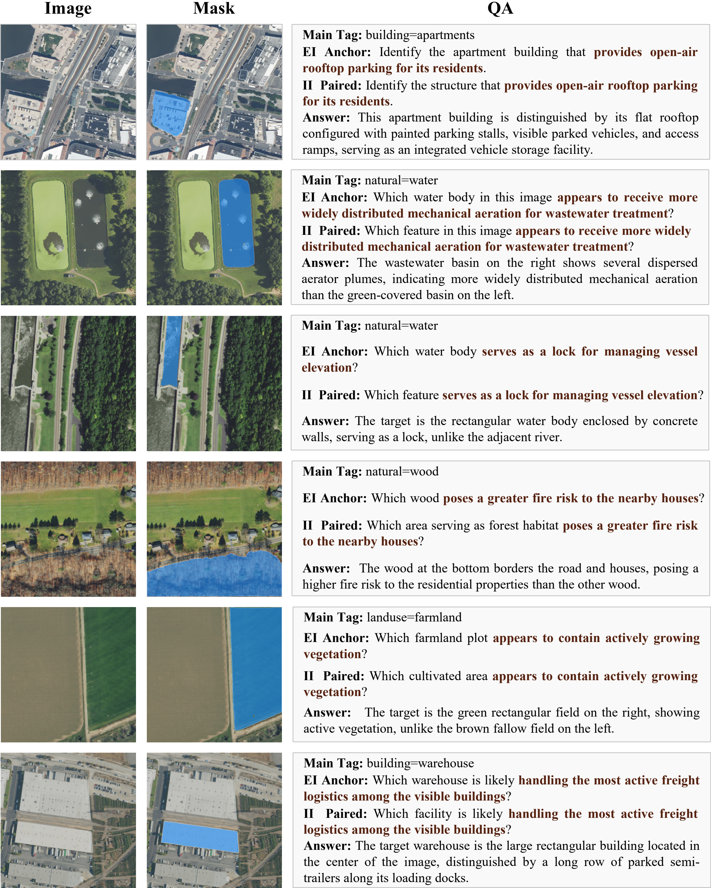
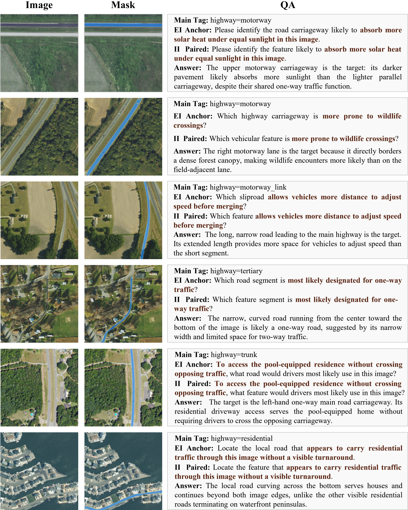
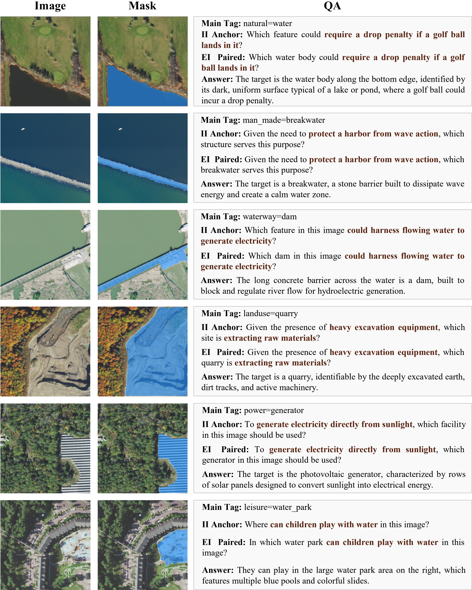
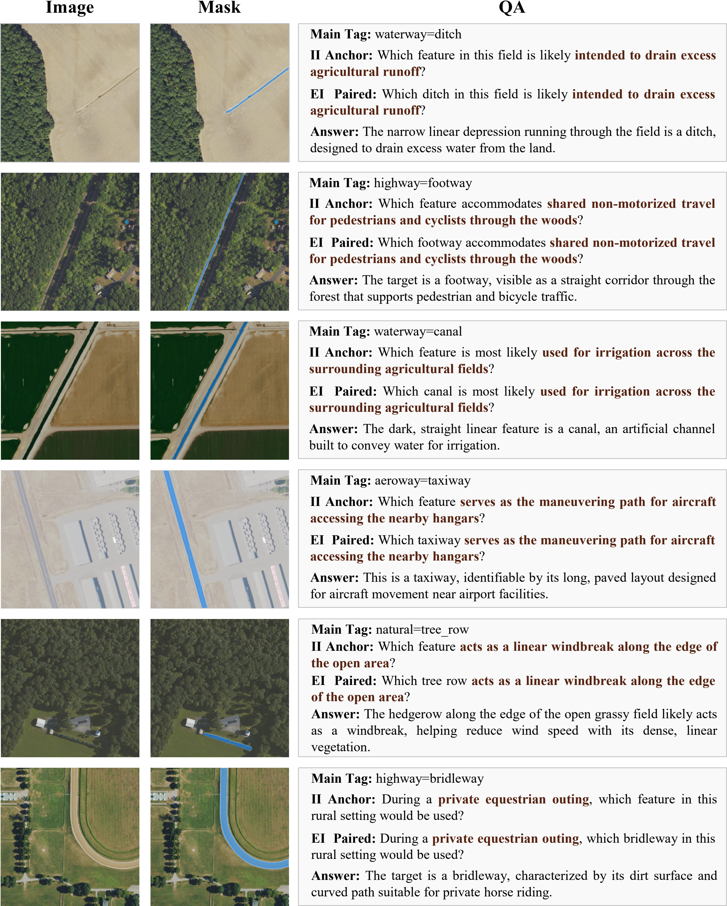
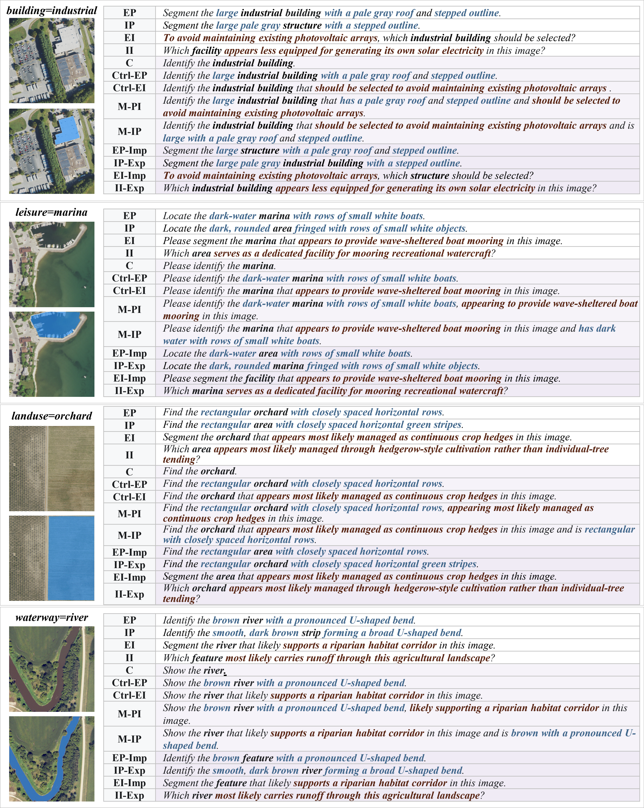
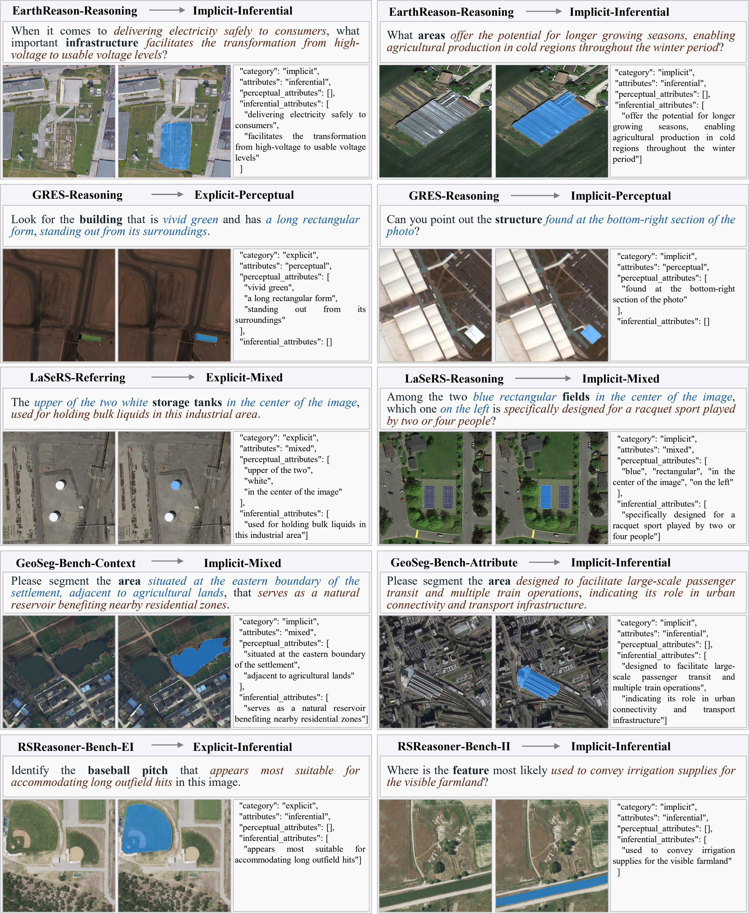

# RSReasoner: Reformulating and Auditing Geospatial Reasoning Segmentation

<!-- [**🤗 RSReasoner**](https://huggingface.co/datasets/RicardoString/RSReasoner) · [**🤗 RSReasoner-Bench**](https://huggingface.co/datasets/RicardoString/RSReasoner-Bench) -->

  
  
  

## Overview

We reformulate geospatial reasoning segmentation along two complementary dimensions: **category expression** (explicit vs. implicit) and **attribute nature** (perceptual vs. inferential). Extending the conventional referring-versus-reasoning distinction to two dimensions makes language queries auditable and allows their reasoning demands to be characterized more precisely.

Building on this formulation, we provide:

- **RSReasoner:** A large-scale geospatial reasoning segmentation dataset with 106,610 images and 213,220 paired explicit-inferential and implicit-inferential queries grounded in OpenStreetMap (OSM) semantics.
- **RSReasoner-Bench:** A diagnostic benchmark with 5,800 targets and 75,400 queries across 13 conditions for precise, controlled evaluation of model capabilities.
- **A taxonomy audit:** Analysis of 90,708 queries from existing geospatial reasoning benchmarks, showing limited coverage of explicit-inferential queries and frequent mixing of perceptual and inferential attributes.

## Query Formulation

- **Category expression**: Category expression characterizes whether the target's canonical category is explicitly named or implicitly generalized to a coarser hypernym.
- **Attribute nature**: Attribute nature characterizes whether the target-defining attributes are perceptual, directly observable from the image (e.g., color, shape, and position), or inferential, requiring geospatial knowledge or contextual reasoning (e.g., land-use function, traffic semantics, and environmental risk).

| Query type | Category expression | Attribute nature |
| --- | --- | --- |
| **EP** — Explicit-Perceptual | Explicit category name | Perceptual attributes |
| **IP** — Implicit-Perceptual | Coarser hypernym | Perceptual attributes |
| **EI** — Explicit-Inferential | Explicit category name | Inferential attributes |
| **II** — Implicit-Inferential | Coarser hypernym | Inferential attributes |

## Datasets

| Dataset | Split | Targets | Query-mask pairs |
| --- | --- | ---: | ---: |
| [**RSReasoner**](https://huggingface.co/datasets/RicardoString/RSReasoner) | `train` | 95,150 | 190,300 |
| [**RSReasoner**](https://huggingface.co/datasets/RicardoString/RSReasoner) | `validation` | 5,660 | 11,320 |
| [**RSReasoner-Bench**](https://huggingface.co/datasets/RicardoString/RSReasoner-Bench) | `test` | 5,800 | 75,400 |

- **RSReasoner:** WebDataset TAR shards in `train/` and `validation/`. Each image has a JSON record containing paired `ei_query` and `ii_query` fields with one shared `answer`.
- **RSReasoner-Bench:** Images in `test/images/` and annotations in `test/metadata.jsonl`. Each record contains 13 query fields, with separate `ei_answer` and `ii_answer` fields.

See the linked dataset cards for complete field definitions and loading examples.

### RSReasoner Examples

👇 **Click a panel to view examples:** images, target masks, OSM main tags, paired EI/II queries, and reasoning answers.

<strong>🖼️ Area targets · EI anchors + paired II — Click to collapse</strong>

<strong>🖼️ Non-area targets · EI anchors + paired II — Click to expand</strong>

<strong>🖼️ Area targets · II anchors + paired EI — Click to expand</strong>

<strong>🖼️ Non-area targets · II anchors + paired EI — Click to expand</strong>

### RSReasoner-Bench: Controlled Evaluation

For each target, RSReasoner-Bench holds the image and mask fixed and provides 13 query conditions. Each condition contains 5,800 queries.

| Group | Conditions |
| --- | --- |
| Canonical queries | `EP`, `IP`, `EI`, `II` |
| Category-only reference | `C` |
| Attribute composition | `Ctrl-EP`, `Ctrl-EI`, `M-PI`, `M-IP` |
| Category replacement | `EP-Imp`, `IP-Exp`, `EI-Imp`, `II-Exp` |

<strong>🖼️ RSReasoner-Bench examples · All 13 query conditions — Click to collapse</strong>

*Representative benchmark examples. Category terms are highlighted in black, perceptual cues in blue, and inferential cues in brown.*

## Auditing Existing Benchmarks

We audit 90,708 queries from EarthReason, GRES, LaSeRS, and GeoSeg-Bench under our formulation. Most reasoning splits are almost entirely category-implicit; across all audited queries, 0.61% are pure explicit-inferential queries and 31.98% mix perceptual and inferential attributes.

The figure illustrates representative taxonomy-audit examples from the four existing benchmarks and RSReasoner-Bench.

<strong>🖼️ Taxonomy-audit examples — Click to collapse</strong>

## Acknowledgments

RSReasoner builds on aerial imagery and OSM annotations provided by [RSTeller](https://github.com/SlytherinGe/RSTeller). We thank the [OpenStreetMap contributors](https://www.openstreetmap.org/copyright) for their open geographic data and the authors of [EarthReason](https://github.com/earth-insights/SegEarth-R1), [GRES](https://github.com/lisat-bair/GRES), [LaSeRS](https://github.com/earth-insights/SegEarth-R2), and [GeoSeg-Bench](https://github.com/MiliLab/UniGeoSeg) for advancing geospatial reasoning segmentation.